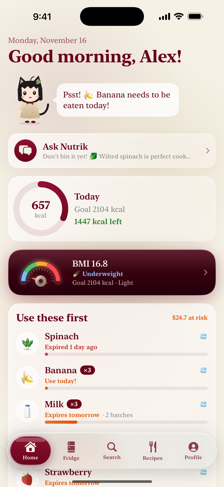
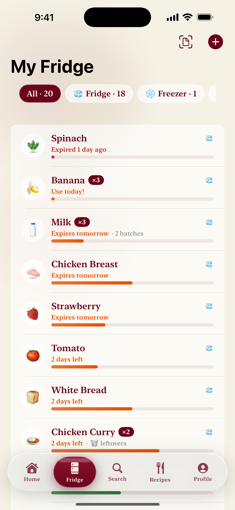
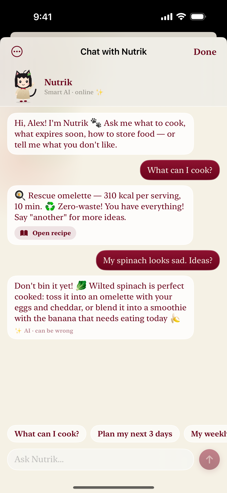
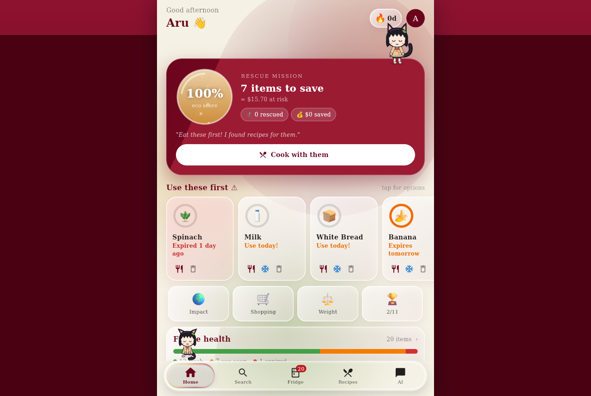

# NutriMate 🥕 — less food thrown away

**NutriMate** helps you use up what's already in your fridge: it remembers what you bought, warns you before food goes bad,
suggests recipes for exactly those products and counts the food and money you saved. Nutrik — a small, clumsy, very cute
helper — answers questions about cooking and storage in **English, Russian and Kazakh**.

A student project for the course **CEE 181 "Fostering Sustainability in Almaty"** — about one simple idea: the greenest food
is the food you don't throw away.

**NutriMate** помогает доедать то, что уже лежит в холодильнике: помнит покупки, предупреждает, пока еда ещё не испортилась,
подбирает рецепты именно из этих продуктов и считает спасённую еду и деньги. Нутрик — маленький неуклюжий помощник —
отвечает на вопросы о готовке и хранении на русском, казахском и английском. Студенческий проект курса CEE 181
«Fostering Sustainability in Almaty».

<p>
  
  
  
  
</p>
<p>
  
  
  
</p>

## What it does · Что умеет
- 🧊 **Fridge with dates** — every product shows how many days it has left; "use today" ones come first.
- 📷 **Add by photo** — take a photo of groceries or a receipt, check what Nutrik found, add it in one tap
  (the photo is used only for recognition and is never stored). Or paste a whole shopping list.
- 🍳 **Recipes from what you have** — 180 recipes, zero-waste ones marked ♻️, step-by-step cooking mode.
- 🛒 **Smart shopping list**, 📊 calories diary, 🌍 your impact (food and money saved), weekly challenges and medals.
- 🇬🇧 🇷🇺 🇰🇿 Three languages, works offline (the online AI is optional and can be turned off in Profile).

## ⬇️ Download · Скачать

| Device · Устройство | Download · Скачать | |
|---|---|---|
| 🤖 **Android** 7+ | [NutriMate-android.apk](https://github.com/TimkaSlowmo/Nutrimate/releases/latest/download/NutriMate-android.apk) | phone / tablet |
| 🪟 **Windows** 10 / 11 | [NutriMate-windows.zip](https://github.com/TimkaSlowmo/Nutrimate/releases/latest/download/NutriMate-windows.zip) | 64-bit |
| 🍎 **macOS** 12+ | [NutriMate-macos.zip](https://github.com/TimkaSlowmo/Nutrimate/releases/latest/download/NutriMate-macos.zip) | Apple Silicon & Intel |
| 🐧 **Linux** | [NutriMate-linux.tar.gz](https://github.com/TimkaSlowmo/Nutrimate/releases/latest/download/NutriMate-linux.tar.gz) | x64, GTK 3 |
| 📱 **iPhone** (iOS 17+) | [NutriMate.ipa](https://github.com/TimkaSlowmo/Nutrimate/releases/latest/download/NutriMate.ipa) | via Sideloadly |
| 🌐 **Browser** | [timkaslowmo.github.io/Nutrimate](https://timkaslowmo.github.io/Nutrimate/) | nothing to install |

The links always point to the newest build (they are rebuilt automatically after every change).
Ссылки всегда ведут на самую свежую сборку — она собирается автоматически после каждого изменения.
All versions: [Releases](https://github.com/TimkaSlowmo/Nutrimate/releases).

## Install · Установка

The apps are free and not sold in stores, so they are not signed by Apple/Microsoft — your system will ask you to confirm once.
Приложение бесплатное и не продаётся в магазинах, поэтому система один раз попросит подтвердить установку.

<details open>
<summary><b>🤖 Android</b></summary>

**EN.** Download `NutriMate-android.apk` on the phone → open it → Android asks to *allow installs from this source*
(Chrome / Files) → allow → **Install**. Updates: install the new APK on top — your data stays.

**RU.** Скачай `NutriMate-android.apk` на телефоне → открой → Android попросит *разрешить установку из этого источника*
(Chrome / Файлы) → разреши → **Установить**. Обновление — просто поставь новый APK поверх, данные сохранятся.
</details>

<details>
<summary><b>🪟 Windows</b></summary>

**EN.** Download `NutriMate-windows.zip` → right-click → **Extract All** → open the `NutriMate` folder → run `NutriMate.exe`.
Windows SmartScreen says "Windows protected your PC" (the app is not signed) → **More info → Run anyway**.
Keep the whole folder together (the `.exe` needs the files next to it).

**RU.** Скачай `NutriMate-windows.zip` → правой кнопкой → **Извлечь всё** → открой папку `NutriMate` → запусти `NutriMate.exe`.
SmartScreen напишет «Система Windows защитила ваш компьютер» (приложение без подписи) → **Подробнее → Выполнить в любом случае**.
Не вынимай `.exe` из папки — рядом лежат нужные ему файлы.
</details>

<details>
<summary><b>🍎 macOS</b></summary>

**EN.** Download `NutriMate-macos.zip` → it unzips to `NutriMate.app` → drag it to **Applications** →
**right-click → Open → Open** (the first time only; the app is not notarized by Apple).
On macOS 15+: if there is no "Open" button, go to **System Settings → Privacy & Security → Open Anyway**.

**RU.** Скачай `NutriMate-macos.zip` → получится `NutriMate.app` → перетащи в **Программы** →
**правой кнопкой → Открыть → Открыть** (только в первый раз: приложение не заверено Apple).
На macOS 15+: если кнопки «Открыть» нет — **Системные настройки → Конфиденциальность и безопасность → Всё равно открыть**.
</details>

<details>
<summary><b>🐧 Linux</b></summary>

**EN.** `tar -xzf NutriMate-linux.tar.gz && ./NutriMate/NutriMate` (needs GTK 3 — already present on Ubuntu, Fedora, Mint…).
Optional menu entry: copy `NutriMate/nutrimate.desktop` to `~/.local/share/applications/`, set `Exec=` to the full path of
`NutriMate/NutriMate`, and `NutriMate/data/nutrimate.png` to `~/.local/share/icons/nutrimate.png`.

**RU.** `tar -xzf NutriMate-linux.tar.gz && ./NutriMate/NutriMate` (нужен GTK 3 — он уже есть в Ubuntu, Fedora, Mint…).
Ярлык в меню (по желанию): скопируй `NutriMate/nutrimate.desktop` в `~/.local/share/applications/`, в строке `Exec=` укажи полный
путь к `NutriMate/NutriMate`, а `NutriMate/data/nutrimate.png` — в `~/.local/share/icons/nutrimate.png`.
</details>

<details>
<summary><b>📱 iPhone</b></summary>

**EN.** On a Mac or Windows PC install [Sideloadly](https://sideloadly.io) → connect the iPhone with a cable → drag `NutriMate.ipa`
into Sideloadly → enter your Apple ID → **Start**. On the iPhone: **Settings → General → VPN & Device Management →** your Apple ID
→ **Trust** (and turn on **Developer Mode** if iOS asks). With a free Apple ID the app works for 7 days — then just install it
again the same way: **reinstalling on top keeps all your data**.

**RU.** Поставь на Mac или ПК [Sideloadly](https://sideloadly.io) → подключи iPhone кабелем → перетащи `NutriMate.ipa`
в Sideloadly → введи свой Apple ID → **Start**. На iPhone: **Настройки → Основные → VPN и управление устройством →** твой Apple ID
→ **Доверять** (и включи **Режим разработчика**, если iOS попросит). С бесплатным Apple ID приложение работает 7 дней — потом
просто установи его так же ещё раз: **установка поверх сохраняет все данные**.
</details>

Your data (fridge, diary, medals) is stored only on your device and survives updates.
Данные (холодильник, дневник, медали) хранятся только на твоём устройстве и сохраняются при обновлениях.

---

## For developers · Для разработчиков

| Part | Where | Built by |
|---|---|---|
| iPhone app (SwiftUI, main version) | `ios/` (XcodeGen `ios/project.yml`) | `.github/workflows/ios.yml` → release `ios-latest` (+ copy in `latest`) |
| Flutter app: web, Android, Windows, macOS, Linux | `lib/`, `android/`, `windows/`, `macos/`, `linux/`, `web/` | `deploy.yml` (GitHub Pages), `apps.yml` (release `latest`) |
| Nutrik AI server (Cloudflare Workers AI, free tier) | `server/` | `server.yml` |

- Every push to `main` rebuilds the website automatically; changes in `lib/`, `assets/`, platform folders or `pubspec.yaml`
  also rebuild all apps (`apps.yml`): Android APK is checked on an emulator (API 34), Linux under Xvfb, Windows/macOS by
  launching the app; screenshots go to the [`ios-screens`](https://github.com/TimkaSlowmo/Nutrimate/tree/ios-screens) branch
  (`android/`, `desktop/`). A platform that fails to build does not block the others.
- App icons for Android/Windows/macOS/Linux: `python3 tool/make_platform_icons.py` (same drawing as the iOS icon, `tool/make_app_icon.py`).
- Translations: `tool/l10n/*.json` → `python3 tool/export_web_l10n.py` → `lib/l10n_data.dart`.

### Food icons · Иконки продуктов
3D icons — [Microsoft Fluent Emoji](https://github.com/microsoft/fluentui-emoji) (MIT license, text in `assets/icons/LICENSE-fluentui-emoji.txt`).
Icons for products without a fitting emoji (`assets/icons/p`) are our own, drawn by `tool/make_icons.py`.
`tool/build_icons.py` rebuilds `lib/food_icons.dart` and checks the food base (duplicates, recipe ingredients, icons).

### Android signing · Подпись Android
Android installs an update only if it is signed with the **same key** as the installed app. The CI does this:

- If the repository has the secrets below, the APK is signed with **your own release key**.
- Without them it uses a fixed debug key committed to the repo (`android/app/nutrimate-debug.keystore`, passwords `android` —
  a public debug key, not a secret), so all builds still share one signature and update each other.

**To switch to your own key (3 steps, once):**

1. On any computer with Java (e.g. Android Studio installed) run:
   ```bash
   keytool -genkeypair -v -keystore nutrimate-release.jks -storetype PKCS12 -keyalg RSA -keysize 2048 \
     -validity 10000 -alias nutrimate -dname "CN=NutriMate, C=KZ"
   ```
   Choose a password and **keep `nutrimate-release.jks` and the password safe** (losing them = users must reinstall). Never commit the file.
2. Turn the file into text: `base64 -w0 nutrimate-release.jks > keystore.txt` (macOS: `base64 -i nutrimate-release.jks -o keystore.txt`;
   Windows PowerShell: `[Convert]::ToBase64String([IO.File]::ReadAllBytes("nutrimate-release.jks")) > keystore.txt`).
3. GitHub → repository **Settings → Secrets and variables → Actions → New repository secret**, add four secrets:
   `ANDROID_KEYSTORE_BASE64` (contents of `keystore.txt`), `ANDROID_KEYSTORE_PASSWORD` (the password),
   `ANDROID_KEY_ALIAS` (`nutrimate`), `ANDROID_KEY_PASSWORD` (the same password). Then run **Actions → Apps → Run workflow**.

⚠️ After switching from the debug key to your own key, phones that already have NutriMate must **uninstall it once and install
the new APK** (Android refuses an update signed by a different key). Uninstalling removes the app's data on that phone, so it
is best to switch keys early. All later updates install on top as usual.

⚠️ После перехода с отладочного ключа на свой на телефонах, где NutriMate уже стоит, нужно **один раз удалить приложение и
поставить новый APK** (Android не ставит обновление с другой подписью; данные на этом телефоне при удалении пропадут —
поэтому ключ лучше сменить пораньше). Дальше обновления ставятся поверх, как обычно.
