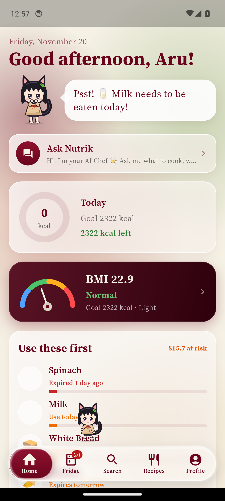

# NutriMate — Android emulator (API 34, Pixel 6)
Build a537510, 2026-11-16 12:32 UTC.

### 00-onboarding

### 01-home

### 02-fridge

### 03-search

### 04-recipes

### 05-chat

### 06-photo-notice

### 07-photo

### 08-photo-review

### 09-fridge-ru

### 10-search-kk

### 11-photo-review-ru

