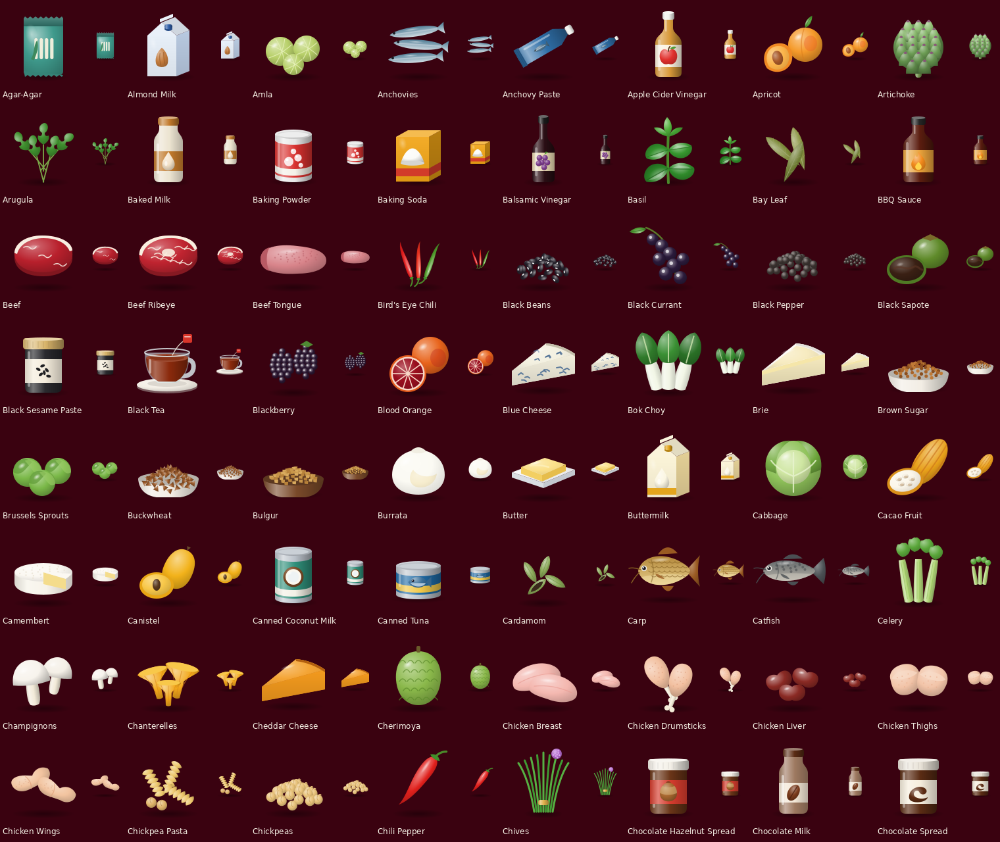
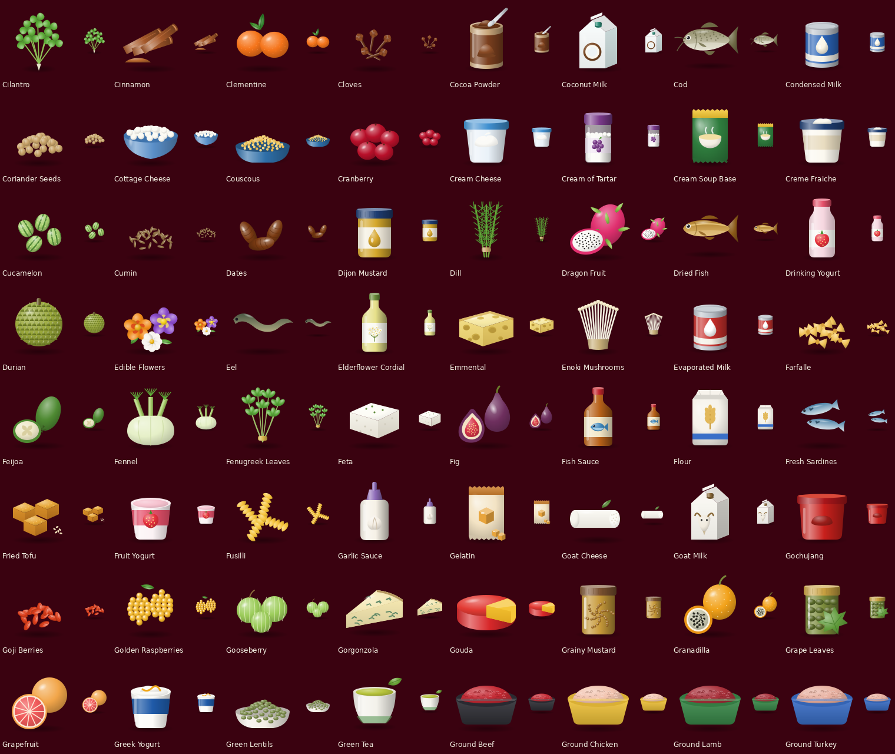
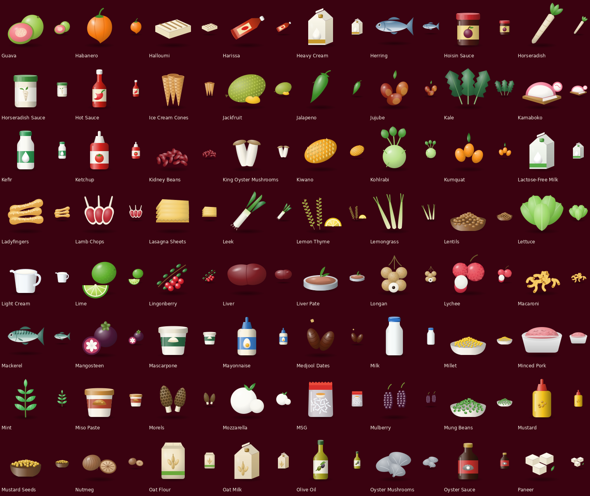
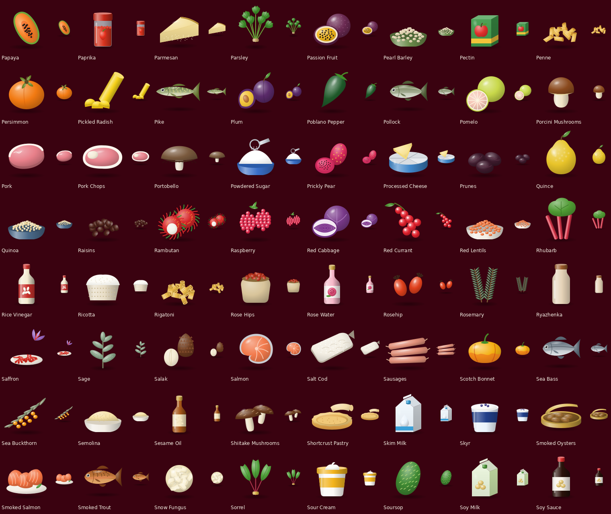
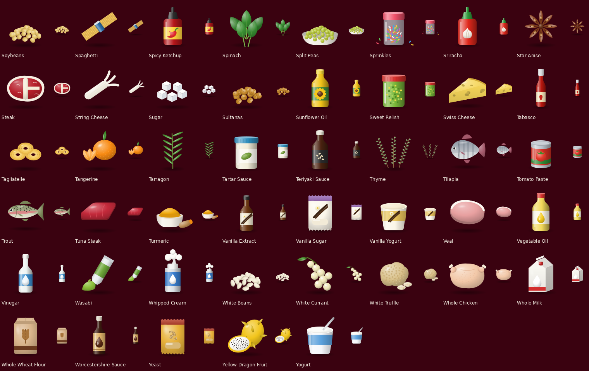

# NutriMate — own product icons

One icon = one product. Drawn as compact SVG (128×128, glossy volumetric style, no outlines) in `assets/icons/<slug>.svg`,
rendered by `tool/build_svg_icons.py` to Flutter (`assets/icons/s`, 128 px) and iOS (`Assets.xcassets/FoodIcons/fi_<slug>`, 180 px).
Sources: `tool/iconlib.py` + `tool/draw_icons.py` (`tool/icons_a…i.py`). Check: `python3 tool/check_icons.py`.

Before this work: 39 of 1912 products had a unique icon.

```
products: unique 343 of 1940 (478 distinct icons, 318 own, 301 SVG)
recipes: unique 26 of 185 (65 distinct emoji); worst: 🍝×11, 🥗×11, 🍜×11, 🍳×7, 🥣×7, 🍚×7
categories: unique 20 of 20
```

301 drawn icons (each cell: 128 px and ~56 px list size on the app's burgundy).







| # | slug | product |
|---|---|---|
| 1 | `agar_agar` | Agar-Agar |
| 2 | `almond_milk` | Almond Milk |
| 3 | `amla` | Amla |
| 4 | `anchovies` | Anchovies |
| 5 | `anchovy_paste` | Anchovy Paste |
| 6 | `apple_cider_vinegar` | Apple Cider Vinegar |
| 7 | `apricot` | Apricot |
| 8 | `artichoke` | Artichoke |
| 9 | `arugula` | Arugula |
| 10 | `baked_milk` | Baked Milk |
| 11 | `baking_powder` | Baking Powder |
| 12 | `baking_soda` | Baking Soda |
| 13 | `balsamic` | Balsamic Vinegar |
| 14 | `basil` | Basil |
| 15 | `bay_leaf` | Bay Leaf |
| 16 | `bbq_sauce` | BBQ Sauce |
| 17 | `beef` | Beef |
| 18 | `beef_ribeye` | Beef Ribeye |
| 19 | `beef_tongue` | Beef Tongue |
| 20 | `birds_eye_chili` | Bird's Eye Chili |
| 21 | `black_beans` | Black Beans |
| 22 | `black_currant` | Black Currant |
| 23 | `black_pepper` | Black Pepper |
| 24 | `black_sapote` | Black Sapote |
| 25 | `black_sesame_paste` | Black Sesame Paste |
| 26 | `black_tea` | Black Tea |
| 27 | `blackberry` | Blackberry |
| 28 | `blood_orange` | Blood Orange |
| 29 | `blue_cheese` | Blue Cheese |
| 30 | `bok_choy` | Bok Choy |
| 31 | `brie` | Brie |
| 32 | `brown_sugar` | Brown Sugar |
| 33 | `brussels_sprouts` | Brussels Sprouts |
| 34 | `buckwheat` | Buckwheat |
| 35 | `bulgur` | Bulgur |
| 36 | `burrata` | Burrata |
| 37 | `butter` | Butter |
| 38 | `buttermilk` | Buttermilk |
| 39 | `cabbage` | Cabbage |
| 40 | `cacao_fruit` | Cacao Fruit |
| 41 | `camembert` | Camembert |
| 42 | `canistel` | Canistel |
| 43 | `canned_coconut_milk` | Canned Coconut Milk |
| 44 | `canned_tuna` | Canned Tuna |
| 45 | `cardamom` | Cardamom |
| 46 | `carp` | Carp |
| 47 | `catfish` | Catfish |
| 48 | `celery` | Celery |
| 49 | `champignons` | Champignons |
| 50 | `chanterelles` | Chanterelles |
| 51 | `cheddar` | Cheddar Cheese |
| 52 | `cherimoya` | Cherimoya |
| 53 | `chicken_breast` | Chicken Breast |
| 54 | `chicken_drumsticks` | Chicken Drumsticks |
| 55 | `chicken_liver` | Chicken Liver |
| 56 | `chicken_thighs` | Chicken Thighs |
| 57 | `chicken_wings` | Chicken Wings |
| 58 | `chickpea_pasta` | Chickpea Pasta |
| 59 | `chickpeas` | Chickpeas |
| 60 | `chili_pepper` | Chili Pepper |
| 61 | `chives` | Chives |
| 62 | `choc_hazelnut_spread` | Chocolate Hazelnut Spread |
| 63 | `chocolate_milk` | Chocolate Milk |
| 64 | `chocolate_spread` | Chocolate Spread |
| 65 | `cilantro` | Cilantro |
| 66 | `cinnamon` | Cinnamon |
| 67 | `clementine` | Clementine |
| 68 | `cloves` | Cloves |
| 69 | `cocoa_powder` | Cocoa Powder |
| 70 | `coconut_milk` | Coconut Milk |
| 71 | `cod` | Cod |
| 72 | `condensed_milk` | Condensed Milk |
| 73 | `coriander_seeds` | Coriander Seeds |
| 74 | `cottage_cheese` | Cottage Cheese |
| 75 | `couscous` | Couscous |
| 76 | `cranberry` | Cranberry |
| 77 | `cream_cheese` | Cream Cheese |
| 78 | `cream_of_tartar` | Cream of Tartar |
| 79 | `cream_soup_base` | Cream Soup Base |
| 80 | `creme_fraiche` | Creme Fraiche |
| 81 | `cucamelon` | Cucamelon |
| 82 | `cumin` | Cumin |
| 83 | `dates` | Dates |
| 84 | `dijon_mustard` | Dijon Mustard |
| 85 | `dill` | Dill |
| 86 | `dragon_fruit` | Dragon Fruit |
| 87 | `dried_fish` | Dried Fish |
| 88 | `drinking_yogurt` | Drinking Yogurt |
| 89 | `durian` | Durian |
| 90 | `edible_flowers` | Edible Flowers |
| 91 | `eel` | Eel |
| 92 | `elderflower_cordial` | Elderflower Cordial |
| 93 | `emmental` | Emmental |
| 94 | `enoki` | Enoki Mushrooms |
| 95 | `evaporated_milk` | Evaporated Milk |
| 96 | `farfalle` | Farfalle |
| 97 | `feijoa` | Feijoa |
| 98 | `fennel` | Fennel |
| 99 | `fenugreek_leaves` | Fenugreek Leaves |
| 100 | `feta` | Feta |
| 101 | `fig` | Fig |
| 102 | `fish_sauce` | Fish Sauce |
| 103 | `flour` | Flour |
| 104 | `fresh_sardines` | Fresh Sardines |
| 105 | `fried_tofu` | Fried Tofu |
| 106 | `fruit_yogurt` | Fruit Yogurt |
| 107 | `fusilli` | Fusilli |
| 108 | `garlic_sauce` | Garlic Sauce |
| 109 | `gelatin` | Gelatin |
| 110 | `goat_cheese` | Goat Cheese |
| 111 | `goat_milk` | Goat Milk |
| 112 | `gochujang` | Gochujang |
| 113 | `goji` | Goji Berries |
| 114 | `golden_raspberries` | Golden Raspberries |
| 115 | `gooseberry` | Gooseberry |
| 116 | `gorgonzola` | Gorgonzola |
| 117 | `gouda` | Gouda |
| 118 | `grainy_mustard` | Grainy Mustard |
| 119 | `granadilla` | Granadilla |
| 120 | `grape_leaves` | Grape Leaves |
| 121 | `grapefruit` | Grapefruit |
| 122 | `greek_yogurt` | Greek Yogurt |
| 123 | `green_lentils` | Green Lentils |
| 124 | `green_tea` | Green Tea |
| 125 | `ground_beef` | Ground Beef |
| 126 | `ground_chicken` | Ground Chicken |
| 127 | `ground_lamb` | Ground Lamb |
| 128 | `ground_turkey` | Ground Turkey |
| 129 | `guava` | Guava |
| 130 | `habanero` | Habanero |
| 131 | `halloumi` | Halloumi |
| 132 | `harissa` | Harissa |
| 133 | `heavy_cream` | Heavy Cream |
| 134 | `herring` | Herring |
| 135 | `hoisin_sauce` | Hoisin Sauce |
| 136 | `horseradish` | Horseradish |
| 137 | `horseradish_sauce` | Horseradish Sauce |
| 138 | `hot_sauce` | Hot Sauce |
| 139 | `ice_cream_cones` | Ice Cream Cones |
| 140 | `jackfruit` | Jackfruit |
| 141 | `jalapeno` | Jalapeno |
| 142 | `jujube` | Jujube |
| 143 | `kale` | Kale |
| 144 | `kamaboko` | Kamaboko |
| 145 | `kefir` | Kefir |
| 146 | `ketchup` | Ketchup |
| 147 | `kidney_beans` | Kidney Beans |
| 148 | `king_oyster` | King Oyster Mushrooms |
| 149 | `kiwano` | Kiwano |
| 150 | `kohlrabi` | Kohlrabi |
| 151 | `kumquat` | Kumquat |
| 152 | `lactose_free_milk` | Lactose-Free Milk |
| 153 | `ladyfingers` | Ladyfingers |
| 154 | `lamb_chops` | Lamb Chops |
| 155 | `lasagna_sheets` | Lasagna Sheets |
| 156 | `leek` | Leek |
| 157 | `lemon_thyme` | Lemon Thyme |
| 158 | `lemongrass` | Lemongrass |
| 159 | `lentils` | Lentils |
| 160 | `lettuce` | Lettuce |
| 161 | `light_cream` | Light Cream |
| 162 | `lime` | Lime |
| 163 | `lingonberry` | Lingonberry |
| 164 | `liver` | Liver |
| 165 | `liver_pate` | Liver Pate |
| 166 | `longan` | Longan |
| 167 | `lychee` | Lychee |
| 168 | `macaroni` | Macaroni |
| 169 | `mackerel` | Mackerel |
| 170 | `mangosteen` | Mangosteen |
| 171 | `mascarpone` | Mascarpone |
| 172 | `mayonnaise` | Mayonnaise |
| 173 | `medjool_dates` | Medjool Dates |
| 174 | `milk` | Milk |
| 175 | `millet` | Millet |
| 176 | `minced_pork` | Minced Pork |
| 177 | `mint` | Mint |
| 178 | `miso_paste` | Miso Paste |
| 179 | `morels` | Morels |
| 180 | `mozzarella` | Mozzarella |
| 181 | `msg` | MSG |
| 182 | `mulberry` | Mulberry |
| 183 | `mung_beans` | Mung Beans |
| 184 | `mustard` | Mustard |
| 185 | `mustard_seeds` | Mustard Seeds |
| 186 | `nutmeg` | Nutmeg |
| 187 | `oat_flour` | Oat Flour |
| 188 | `oat_milk` | Oat Milk |
| 189 | `olive_oil` | Olive Oil |
| 190 | `oyster_mushrooms` | Oyster Mushrooms |
| 191 | `oyster_sauce` | Oyster Sauce |
| 192 | `paneer` | Paneer |
| 193 | `papaya` | Papaya |
| 194 | `paprika` | Paprika |
| 195 | `parmesan` | Parmesan |
| 196 | `parsley` | Parsley |
| 197 | `passion_fruit` | Passion Fruit |
| 198 | `pearl_barley` | Pearl Barley |
| 199 | `pectin` | Pectin |
| 200 | `penne` | Penne |
| 201 | `persimmon` | Persimmon |
| 202 | `pickled_radish` | Pickled Radish |
| 203 | `pike` | Pike |
| 204 | `plum` | Plum |
| 205 | `poblano` | Poblano Pepper |
| 206 | `pollock` | Pollock |
| 207 | `pomelo` | Pomelo |
| 208 | `porcini` | Porcini Mushrooms |
| 209 | `pork` | Pork |
| 210 | `pork_chops` | Pork Chops |
| 211 | `portobello` | Portobello |
| 212 | `powdered_sugar` | Powdered Sugar |
| 213 | `prickly_pear` | Prickly Pear |
| 214 | `processed_cheese` | Processed Cheese |
| 215 | `prunes` | Prunes |
| 216 | `quince` | Quince |
| 217 | `quinoa` | Quinoa |
| 218 | `raisins` | Raisins |
| 219 | `rambutan` | Rambutan |
| 220 | `raspberry` | Raspberry |
| 221 | `red_cabbage` | Red Cabbage |
| 222 | `red_currant` | Red Currant |
| 223 | `red_lentils` | Red Lentils |
| 224 | `rhubarb` | Rhubarb |
| 225 | `rice_vinegar` | Rice Vinegar |
| 226 | `ricotta` | Ricotta |
| 227 | `rigatoni` | Rigatoni |
| 228 | `rose_hips` | Rose Hips |
| 229 | `rose_water` | Rose Water |
| 230 | `rosehip` | Rosehip |
| 231 | `rosemary` | Rosemary |
| 232 | `ryazhenka` | Ryazhenka |
| 233 | `saffron` | Saffron |
| 234 | `sage` | Sage |
| 235 | `salak` | Salak |
| 236 | `salmon` | Salmon |
| 237 | `salt_cod` | Salt Cod |
| 238 | `sausages` | Sausages |
| 239 | `scotch_bonnet` | Scotch Bonnet |
| 240 | `sea_bass` | Sea Bass |
| 241 | `sea_buckthorn` | Sea Buckthorn |
| 242 | `semolina` | Semolina |
| 243 | `sesame_oil` | Sesame Oil |
| 244 | `shiitake` | Shiitake Mushrooms |
| 245 | `shortcrust_pastry` | Shortcrust Pastry |
| 246 | `skim_milk` | Skim Milk |
| 247 | `skyr` | Skyr |
| 248 | `smoked_oysters` | Smoked Oysters |
| 249 | `smoked_salmon` | Smoked Salmon |
| 250 | `smoked_trout` | Smoked Trout |
| 251 | `snow_fungus` | Snow Fungus |
| 252 | `sorrel` | Sorrel |
| 253 | `sour_cream` | Sour Cream |
| 254 | `soursop` | Soursop |
| 255 | `soy_milk` | Soy Milk |
| 256 | `soy_sauce` | Soy Sauce |
| 257 | `soybeans` | Soybeans |
| 258 | `spaghetti` | Spaghetti |
| 259 | `spicy_ketchup` | Spicy Ketchup |
| 260 | `spinach` | Spinach |
| 261 | `split_peas` | Split Peas |
| 262 | `sprinkles` | Sprinkles |
| 263 | `sriracha` | Sriracha |
| 264 | `star_anise` | Star Anise |
| 265 | `steak` | Steak |
| 266 | `string_cheese` | String Cheese |
| 267 | `sugar` | Sugar |
| 268 | `sultanas` | Sultanas |
| 269 | `sunflower_oil` | Sunflower Oil |
| 270 | `sweet_relish` | Sweet Relish |
| 271 | `swiss_cheese` | Swiss Cheese |
| 272 | `tabasco` | Tabasco |
| 273 | `tagliatelle` | Tagliatelle |
| 274 | `tangerine` | Tangerine |
| 275 | `tarragon` | Tarragon |
| 276 | `tartar_sauce` | Tartar Sauce |
| 277 | `teriyaki` | Teriyaki Sauce |
| 278 | `thyme` | Thyme |
| 279 | `tilapia` | Tilapia |
| 280 | `tomato_paste` | Tomato Paste |
| 281 | `trout` | Trout |
| 282 | `tuna_steak` | Tuna Steak |
| 283 | `turmeric` | Turmeric |
| 284 | `vanilla_extract` | Vanilla Extract |
| 285 | `vanilla_sugar` | Vanilla Sugar |
| 286 | `vanilla_yogurt` | Vanilla Yogurt |
| 287 | `veal` | Veal |
| 288 | `vegetable_oil` | Vegetable Oil |
| 289 | `vinegar` | Vinegar |
| 290 | `wasabi` | Wasabi |
| 291 | `whipped_cream` | Whipped Cream |
| 292 | `white_beans` | White Beans |
| 293 | `white_currant` | White Currant |
| 294 | `white_truffle` | White Truffle |
| 295 | `whole_chicken` | Whole Chicken |
| 296 | `whole_milk` | Whole Milk |
| 297 | `whole_wheat_flour` | Whole Wheat Flour |
| 298 | `worcestershire` | Worcestershire Sauce |
| 299 | `yeast` | Yeast |
| 300 | `yellow_dragon_fruit` | Yellow Dragon Fruit |
| 301 | `yogurt` | Yogurt |
